<p align="center">
  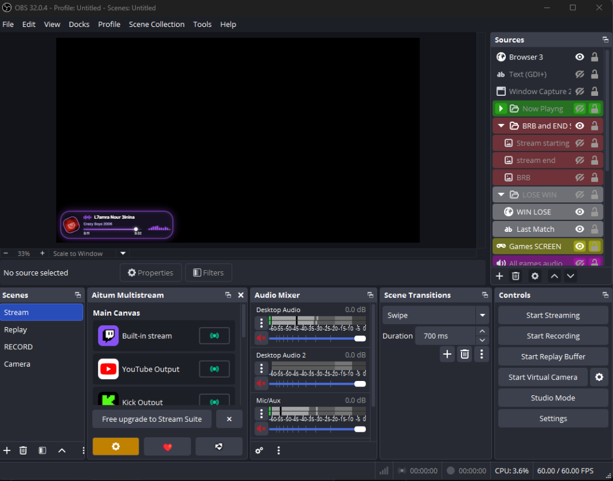
</p>

<h1 align="center">🎵 Spotify Now Playing — OBS Overlay Studio</h1>

<p align="center">
  <b>A lightweight, beautiful, real-time customizable Spotify overlay for OBS Studio.</b><br/>
  Detects currently playing music automatically with Windows Media Controls — <b>no Spotify API key or setup required</b>.<br/>
  Double-click <code>start.bat</code> and you're ready to stream.
</p>

<p align="center">
  
  
  
  
  
</p>

---

## 🪟 Standalone Control Panel ("Comme un logiciel")

No browser tabs, no search bars. A native desktop window launches automatically to customize your overlay in real time:

<p align="center">
  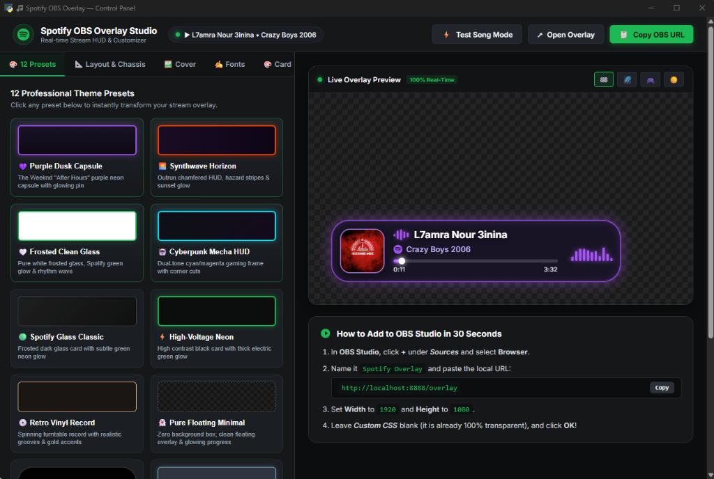
</p>

---

## 🎨 Professional Theme Presets

Switch between 12+ styles instantly with matching glowing rhythm spectrum visualizers:

<table>
  <tr>
    <td align="center" width="50%">
      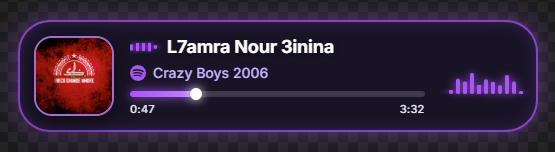<br/>
      <b>💜 Purple Dusk Capsule</b>
    </td>
    <td align="center" width="50%">
      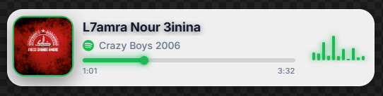<br/>
      <b>🤍 Frosted Clean Glass</b>
    </td>
  </tr>
  <tr>
    <td align="center" width="50%">
      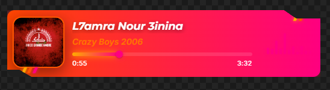<br/>
      <b>🌅 Synthwave Horizon</b>
    </td>
    <td align="center" width="50%">
      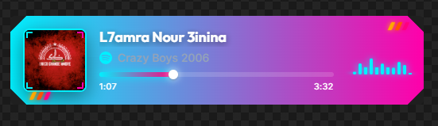<br/>
      <b>🤖 Cyberpunk Mecha HUD</b>
    </td>
  </tr>
  <tr>
    <td align="center" width="50%">
      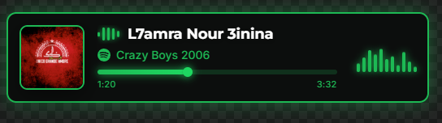<br/>
      <b>⚡ High-Voltage Neon</b>
    </td>
    <td align="center" width="50%">
      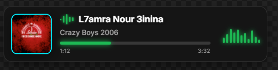<br/>
      <b>🟢 Spotify Glass Classic</b>
    </td>
  </tr>
  <tr>
    <td align="center" width="50%">
      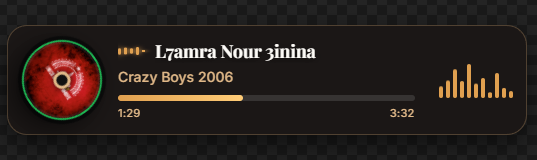<br/>
      <b>💿 Retro Vinyl Record</b>
    </td>
    <td align="center" width="50%">
      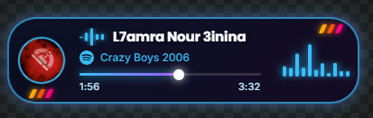<br/>
      <b>🌌 Deep Space Nebula</b>
    </td>
  </tr>
  <tr>
    <td align="center" width="50%">
      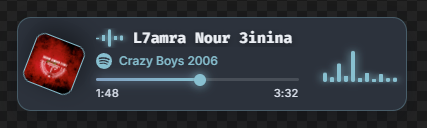<br/>
      <b>❄️ Nord Arctic Frost</b>
    </td>
    <td align="center" width="50%">
      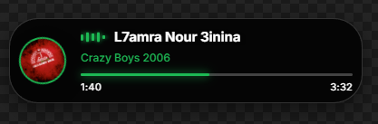<br/>
      <b>💊 Compact Streamer Pill</b>
    </td>
  </tr>
</table>

---

## ✨ Features

- 🎵 **Zero API Keys Required**: Uses Windows Media Transport Controls (GSMTC) to automatically fetch track title, artist, album, duration, and live cover art.
- 🌊 **Audio Rhythm Visualizer**: Smooth animated spectrum equalizer bars with custom glow that match each preset's color.
- ⚡ **60 FPS Smooth Progress**: Sub-pixel interpolated progress bar with glowing circular thumb handle.
- 🎛️ **Native Desktop Customizer**: Standalone software window (powered by `pywebview`) to change fonts, colors, borders, album shapes, animations, and opacity on the fly.
- 📡 **Real-Time Live Preview**: Instant 2-way WebSocket synchronization between the desktop control panel and your OBS overlay.
- 📺 **100% Transparent in OBS**: Optimized 1920×1080 transparent Browser Source with GPU acceleration and ultra-low CPU usage.
- 💾 **Local Configuration**: Settings are saved locally in `config.json`.

---

## 🚀 Quick Start (Installation)

### Prerequisites
- **Windows 10 or 11**
- **Python 3.10+** — [Download Python](https://www.python.org/downloads/) *(Make sure to check **"Add Python to PATH"** during installation)*
- **Spotify Desktop** (playing music)
- **OBS Studio** — [Download OBS](https://obsproject.com/)

---

### Step 1: Download the Project

Click the green **`Code`** button above and select **`Download ZIP`**, then extract the folder anywhere on your PC.

*Or using Git:*
```bash
git clone https://github.com/yjalli/spotify-obs-overlay.git
cd spotify-obs-overlay
```

---

### Step 2: Run `start.bat`

Double-click **`start.bat`**.

It will automatically:
1. Verify Python & install required dependencies (`fastapi`, `uvicorn`, `winsdk`, `websockets`, `pywebview`).
2. Start the local overlay server on `http://localhost:8888`.
3. Launch the native Control Panel desktop popup window.

---

### Step 3: Add to OBS Studio

1. In OBS Studio, go to **Sources** and click **`+`** ➔ **`Browser`**.
2. Name it **`Spotify Overlay`**.
3. Set **URL** to:
   ```
   http://localhost:8888/overlay
   ```
4. Set **Width**: `1920`, **Height**: `1080`.
5. Check **`Shutdown source when not visible`**.
6. Click **OK**.

Your overlay is now active and transparent! 🎉

---

## 📁 Project Structure

```
spotify-obs-overlay/
├── start.bat              # One-click launcher
├── launcher.py            # Background server + native desktop window
├── server.py              # FastAPI server + Windows Media Control integration
├── requirements.txt       # Python dependencies
├── config.json            # Saved user settings (auto-created)
├── screenshots/           # Theme preview images
└── static/
    ├── overlay.html       # Transparent OBS browser source
    ├── overlay.css        # Animations, glowing chassis, spectrum bars
    ├── overlay.js         # WebSocket sync & 60fps progress interpolation
    ├── customizer.html    # Control panel interface
    ├── customizer.css     # Dark mode studio styling
    └── customizer.js      # Live preview & preset switcher
```

---

## 📜 License

This project is licensed under the MIT License — free for streamers and creators to use and modify.
