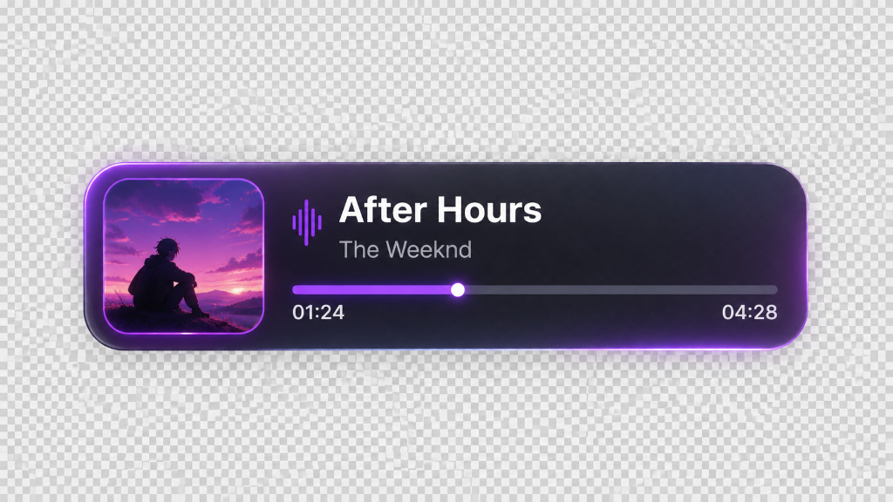
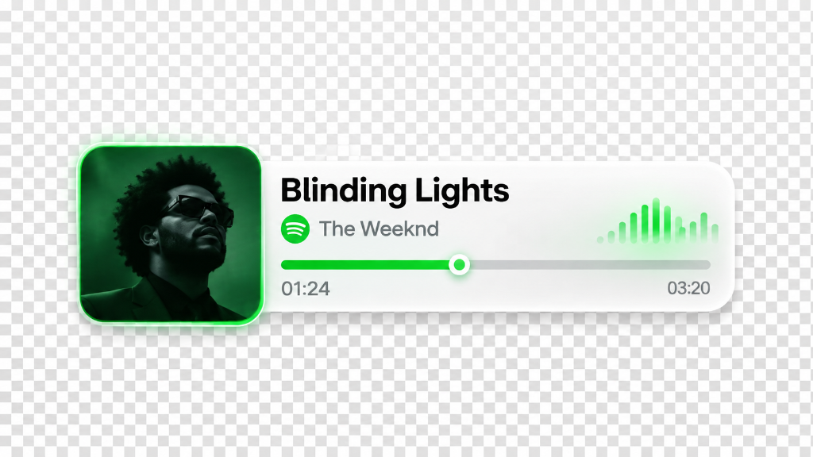
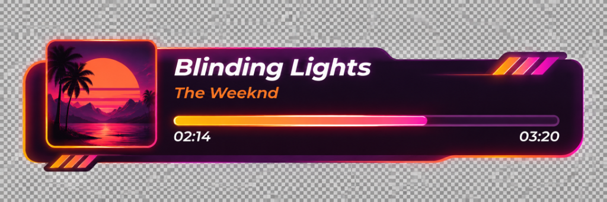
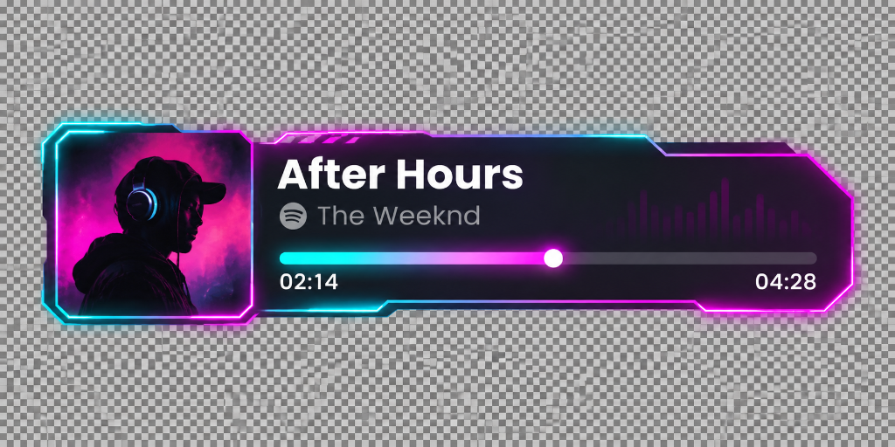

<p align="center">
  
  
</p>

<h1 align="center">🎵 Spotify Now Playing — OBS Overlay</h1>

<p align="center">
  <b>A beautiful, fully customizable Spotify overlay for OBS — no API key needed.</b><br/>
  Double-click <code>start.bat</code> and you're live.
</p>

<p align="center">
  
  
  
  
</p>

---

## ✨ Features

| Feature | Details |
|---------|---------|
| 🎵 **Auto-detect** | Reads the currently playing Spotify track in real time — no API key |
| 🖼️ **Album art** | Full artwork stream from Spotify |
| 📊 **Progress bar** | 60 FPS smooth interpolated progress with glowing thumb |
| 🌊 **Rhythm visualizer** | Animated spectrum bars in each preset's accent color |
| 🎨 **12 presets** | Purple Dusk, Synthwave Horizon, Frosted Glass, Mecha HUD, and 8 more |
| ⚙️ **Live customizer** | Native desktop popup panel — change fonts, colors, animations in real time |
| 📺 **OBS ready** | Transparent 1920×1080 Browser Source, no background |
| 💾 **Local storage** | Settings saved in `config.json` — no cloud, no login |
| 🪟 **Windows native** | Standalone app popup — no browser tabs, no address bar |

---

## 🖼️ Theme Previews

<table>
  <tr>
    <td align="center"><br/><b>💜 Purple Dusk Capsule</b></td>
    <td align="center"><br/><b>🌅 Synthwave Horizon</b></td>
  </tr>
  <tr>
    <td align="center"><br/><b>🤍 Frosted Clean Glass</b></td>
    <td align="center"><br/><b>🤖 Cyberpunk Mecha HUD</b></td>
  </tr>
</table>


---

## 🚀 Installation (5 minutes)

### Requirements
- **Windows 10 or 11**
- **Python 3.10+** — [Download here](https://www.python.org/downloads/) *(check "Add Python to PATH")*
- **Spotify** — open and playing
- **OBS Studio** — [Download here](https://obsproject.com/)

---

### Step 1 — Download

**Option A — Git clone:**
```bash
git clone https://github.com/yjalli/spotify-obs-overlay.git
cd spotify-obs-overlay
```

**Option B — ZIP download:**
1. Click the green **`Code`** button on this page
2. Click **`Download ZIP`**
3. Extract the folder anywhere you want

---

### Step 2 — Launch

Double-click **`start.bat`**

That's it! It will:
- Install all Python dependencies automatically
- Start the local server
- Open the **Control Panel** desktop popup

> ⚠️ Windows Defender might ask "Allow this app?" → click **Yes / Allow access**

---

### Step 3 — Add to OBS

1. In OBS, click **`+`** → **`Browser Source`**
2. Set URL to: `http://localhost:8888/overlay`
3. Set Width: **`1920`** · Height: **`1080`**
4. Check **`Shutdown source when not visible`** ✅
5. Click **OK**

Your overlay is now live! 🎉

---

## 🎨 Customizer Panel

After launching `start.bat`, a **desktop popup** opens:

- 🎨 **12 presets** — click any to apply instantly
- 🖌️ Change colors, fonts, border, background, opacity
- 📐 Adjust card size, album shape, padding, position
- 🌊 Toggle the rhythm wave visualizer and pick its color
- 📺 Live preview — see changes in real time
- 💾 Save button — persists your settings to `config.json`

---

## 📁 Project Structure

```
spotify-obs-overlay/
├── start.bat          ← Double-click to launch everything
├── launcher.py        ← Starts server + opens native popup window
├── server.py          ← FastAPI backend + Windows Media detection
├── requirements.txt   ← Python dependencies
├── config.json        ← Your saved settings (auto-created)
└── static/
    ├── overlay.html   ← The OBS overlay page
    ├── overlay.css    ← All overlay styles & animations
    ├── overlay.js     ← WebSocket controller + 60fps progress
    ├── customizer.html← Customizer UI
    ├── customizer.css ← Customizer styles
    └── customizer.js  ← Live preview + preset switcher
```

---

## ⚙️ How it works

```
Spotify (playing) ──► Windows Media Transport Controls
                              │
                        server.py (FastAPI)
                         /            \
              /overlay           /customizer
         (OBS Browser)      (Desktop popup)
                │                   │
            WebSocket ──────────────┘
         (real-time sync)
```

- Uses **Windows Media Transport Controls (GSMTC)** to read the currently playing track — works with Spotify, no API key needed
- A local **FastAPI + WebSocket** server syncs the overlay and customizer in real time
- The overlay runs as an OBS Browser Source at `http://localhost:8888/overlay`

---

## ❓ FAQ

**Q: Does it need a Spotify API key?**  
A: No. It reads from Windows Media Controls, same as your taskbar.

**Q: Does it work with other music apps?**  
A: Yes! Any app that uses Windows Media Controls (Spotify, YouTube Music, etc.)

**Q: The overlay isn't showing in OBS?**  
A: Make sure `start.bat` is running (the console window must stay open). Check the URL is exactly `http://localhost:8888/overlay`.

**Q: How do I make the overlay transparent in OBS?**  
A: The overlay background is already transparent. In OBS, right-click the source → Filters → check there's no background filter applied.

**Q: Can I change the port?**  
A: Yes — edit `PORT = 8888` at the top of `server.py` and `launcher.py`.

---

## 🛠️ Dependencies

| Package | Purpose |
|---------|---------|
| `winsdk` | Read Spotify track info from Windows Media Controls |
| `fastapi` | Local HTTP + WebSocket server |
| `uvicorn` | ASGI server runner |
| `websockets` | Real-time push to overlay |
| `pywebview` | Native desktop popup window |

All installed automatically by `start.bat`.

---

## 📜 License

MIT License — free to use, modify, and share.

---

<p align="center">Made with ❤️ for streamers</p>
